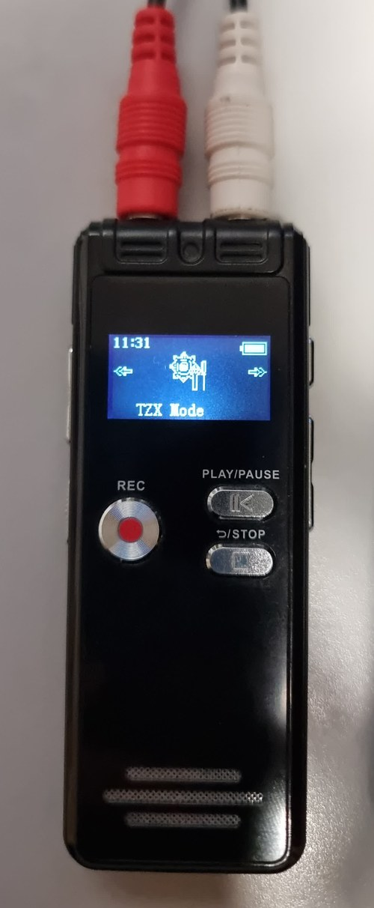
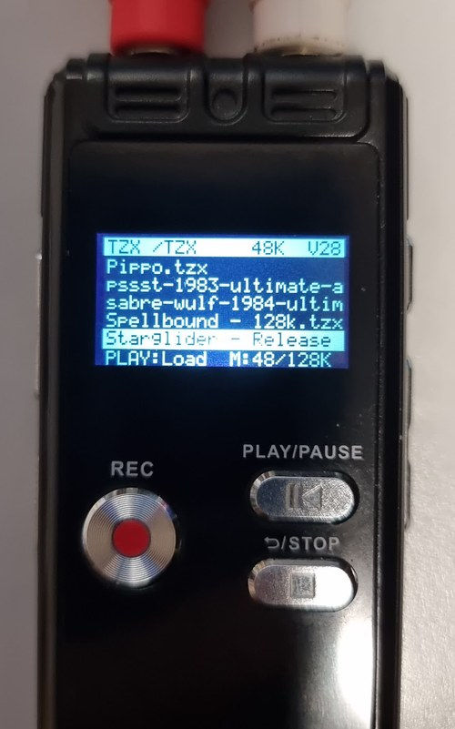
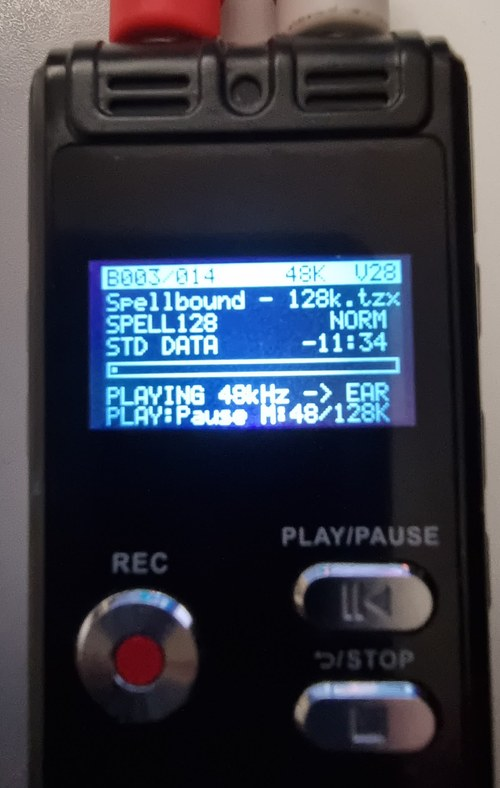
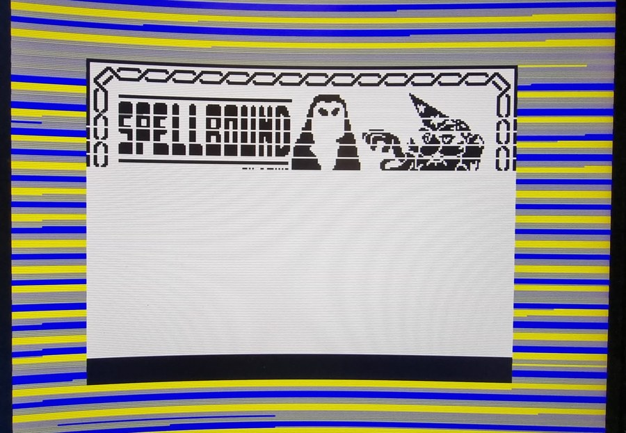

# Pocket-TZX

Custom firmware mode for cheap Actions Semiconductor ATJ2157 digital voice recorders (`10d6:1101`).

It adds a 6th **TZX Mode** entry to the main menu so you can play ZX Spectrum `.TZX` tape files straight from a microSD card over a 3.5 mm audio cable, while keeping all 5 original recorder modes intact.

| Main Menu | File Browser | Playing a Tape |
| :---: | :---: | :---: |
|  |  |  |



## Compatible Hardware

Tested on the generic unbranded "DIGITAL VOICE RECORDER" with:
- Actions `ATJ2157` chip (USB `10d6:1101`, stock firmware `1.101.56`)
- MicroSD card slot
- Small 128x64 monochrome LCD
- Front buttons: `REC`, `PLAY/PAUSE`, `STOP`
- Right side: `M`, `FWD`, `RWD`
- Left side: `+`, `-`, `Power`

Not sure if yours matches? Run the read-only compatibility check first.

## Installing

Plug the recorder into USB (with a microSD card inserted) and wait for the "connected" icon on screen. Python 3 is required (`libusb` on Linux; Windows sets up its own WinUSB driver automatically).

From the release installer folder (built with `python3 tools/make_release_bundle.py`):

**Linux:**
```bash
./install.sh --check   # optional, read-only compatibility check
./install.sh           # backs up stock firmware, then installs
```

**Windows (PowerShell):**
```powershell
powershell -ExecutionPolicy Bypass -File .\install.ps1 -Check
powershell -ExecutionPolicy Bypass -File .\install.ps1
```

A full backup of your original firmware is saved in `backups/` before anything is written.

To restore stock firmware at any time:
```bash
./install.sh --restore backups/<backup_folder>
```
```powershell
powershell -ExecutionPolicy Bypass -File .\install.ps1 -Restore .\backups\<backup_folder>
```

## Using TZX Mode

1. Copy your `.TZX` files into a `/TZX` folder on the microSD card (subfolders work too).
2. Unplug the recorder, scroll to **TZX Mode** on the main menu, and press `PLAY/PAUSE`.
3. Connect a 3.5 mm audio cable from the headphone jack to the EAR input on your Spectrum / Spectrum Next (volume around `28-31` works well).
4. Pick a tape and press `PLAY/PAUSE` to start loading.

### Buttons

- **`PLAY/PAUSE`** (front): Opens a folder or loads the selected `.TZX` file. During playback, pauses or resumes (also resumes after a multi-load tape stop).
- **`STOP`** (front): Goes up a folder (or back to the main menu from the top level). During playback, stops the tape and returns to the file list.
- **`FWD` / `RWD`** (right side): Moves up and down the file list. During playback, skips to the next or previous tape block.
- **`+` / `-`** (left side): Turns the output volume up or down (`0-31`).
- **`M`** (right side): Switches between **48K** and **128K** mode (shown in the top-right corner). In 48K mode, tapes with a "Stop if 48K" block pause automatically; switch to 128K mode to play straight through.
- **`REC`** (front): Flips audio polarity (`NORM` / `INV`) during playback if a particular machine prefers inverted signal edges.
- **`Power`** (left side): Turns the recorder off.

## Not Yet Supported

- **Saving / recording to `.TZX`**: Playback only for now (regular audio recording still works in the stock Record mode).
- **Other tape formats**: No `.TAP` (ZX Spectrum), Commodore 64 (`.TAP`), or Amstrad CPC (`.CDT`) support yet.
- **Rare `.TZX` block types**: CSW (`0x18`) and Generalized Data (`0x19`) blocks are skipped.
- **Windows installer**: `install.ps1` is included, though it has not been tested on a Windows PC yet.

## Technical Notes

Hardware notes, memory maps, build scripts, and recovery instructions are in [docs/](docs/) and [firmware-stock/RECOVERY.md](firmware-stock/RECOVERY.md).
