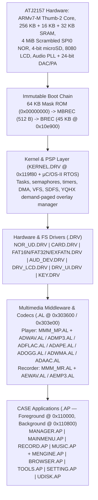

# Actions `ATJ2157` Firmware & Operating System Architecture (`1.101.56`)

## 1. Multi-Layer OS Stack (Proven from Unpacked `lfi_stock.bin`)

Your voice recorder runs **Actions Semiconductor USDK (`20140616_SVN14664_4S_AFI`, firmware `1.101.56`)** — a full preemptive, bank-switched RTOS on the **`ATJ2157` ARM Cortex-M** core:

### Key Architectural Takeaways — **100% Open to Custom Firmware Tweaks!**
1. **No Secure Boot / Signature Lockout on `LFI`**:
   - Mask ROM checks only the 16-bit additive checksum of `MBREC` (`0xe40e`), `BREC` checks only standard 16-bit/32-bit additive checksums of `LFI` (`0xf5c0` header + per-file 32-bit word sums), and `SPI0_CTL` bit 12 (`0x1000`) handles sector scrambling/descrambling transparently in silicon!
   - Zero RSA/ECDSA code-signing exists anywhere in the boot chain (`ECIES` is only used on vendor PC `.FW` archives, which `atjboottool` already encrypts/decrypts).
2. **Standard Open-Source ARMv7-M Compiler Support**:
   - Unlike older MIPS16e `ATJ2127` chips that needed proprietary SDE-MIPS toolchains, `ATJ2157` executes standard **ARMv7-M Thumb-2** instructions (`zig cc -target thumb-freestanding-eabi -mcpu=cortex_m3` — already tested & verified on your live device!).
3. **Generous Storage & Codec Support Already Built In**:
   - All **three** filesystem drivers (`FAT16N.DRV`, `FAT32N.DRV`, **and `EXFATN.DRV`**!) are present in your `lfi_stock.bin`.
   - Full lossless/compressed audio decoder suite (`ADWAV.AL`, `ADFLAC.AL`, `ADAPE.AL`, `ADMP3.AL`, `ADOGG.AL`, `ADAAC.AL`, `ADWMA.AL`) + variable-speed playback (`MMM_VP.AL`) + `MUSIC.AP`/`MENGINE.AP` are already present!
   - **133 KB (`0x21600 B`)** of unused flash headroom sits between the end of `LFI` (`0x3dea00`) and the top of the 4 MiB SPI NOR (`0x400000`).

---

## 2. Complete 75-File Inventory of `lfi_stock.bin` (`1.101.56`)

All 75 files unpacked to `dumps/fw_unpacked/` with **0 checksum errors**:

| Category | Count | Files in `lfi_stock.bin` |
| :--- | :--- | :--- |
| **Kernel & Init** | 4 | `KERNEL.DRV` (`0x119f80`), `KER_TEXT.BIN`, `KER_INIT.BIN`, `KER_DATA.BIN` |
| **Filesystem & Storage `.DRV`** | 7 | `FAT32N.DRV`, `FAT16N.DRV`, `EXFATN.DRV` (`0x301200`), `FMTDATA.BIN`, `NOR_UD.DRV`, `CARD.DRV`, `CARDS.DRV` (`0x11e200`) |
| **Audio, UI & Bus `.DRV`** | 5 | `AUD_DEV.DRV` (`0x307140`), `DRV_UI.DRV`, `KEY.DRV`, `DRV_I2C.DRV`, `DRV_LCD.DRV` (`0x119700`) |
| **Middleware Engines (`.AL`)** | 4 | `MMM_ID.AL` (ID3/tags), `MMM_MP.AL` (Music Player `0x303600`), `MMM_MR.AL` (Recorder `0x110e00`), `MMM_VP.AL` (Variable Speed) |
| **Audio Decoders & Encoders (`.AL`)** | 9 | Decoders (`0x303e00`): `ADWAV.AL`, `ADMP3.AL`, `ADAAC.AL`, `ADWMA.AL`, `ADOGG.AL`, `ADAPE.AL`, `ADFLAC.AL`; Encoders: `AEWAV.AL`, `AEMP3.AL` |
| **CASE Applications (`.AP`)** | 11 | `MANAGER.AP` (`0x113600`), `CONFIG.AP`, `MAINMENU.AP`, `MUSIC.AP`, `MENGINE.AP` (`0x110800`), `BROWSER.AP`, `UDISK.AP` (`0x108800`), `SETTING.AP`, `PLAYLIST.AP`, `TOOLS.AP`, `RECORD.AP` |
| **UI Styles, Fonts & Strings** | 33 | `NEW_M.FNT`, `V936GBK.TBL`, `V1252.TBL`, `1252L.TBL`, `FTBL_GB.$$$`, `COMMON.STY`, `MAINMENU.STY/.MCG`, `MUSIC.STY/.MCG`, `BROWSER.STY/.MCG`, `SETTING.STY/.MCG`, `PLAYLIST.STY`, `TOOLS.STY/.MCG`, `UDISK.STY`, `RECORD.STY/.MCG`, `CONFIG.STY`, `LOGO.STY`, `END.STY`, plus multi-language `.RES`/`.STR` tables |
| **System Configuration** | 2 | `CONFIG.TXT` (`9,728 B`), `CONFIG.BIN` (`2,560 B`) |

---

## 3. Live `CONFIG.TXT` Highlights

Key stock settings verified in `dumps/fw_unpacked/CONFIG.TXT`:
- **Active Main Menu Apps**: `MAINMENU_AP_ID_ARRAY = 6[0, 6, 7, 5, 10]` (6 items enabled out of the full SDK app ID set).
- **Audio & Volume**: `SETTING_AP_ID_VOLUME_LIMIT = 31`, `VOLUME_CURRENT = 28`, `EQ_SETTING = 0` (Off), `FULLSOUND = 0` (Off), `KEYTONE_ENABLE = 0` (Off), `PA_OUTPUT_MODE = 0`.
- **Power & Timers**: `SETTING_AP_ID_LIGHT_TIMER = 60` (`30 s` backlight), `SCREEN_SAVER_MODE = 3` (Screen off), `SCREEN_SAVER_TIMER = 1` (`0.5 s` unit), `POWEROFF_TIMER = 3` (`1.5 min` idle auto-off when stopped — does not power off while `MENGINE.AP` is actively playing).
- **Recording Capabilities**: Supports Mic-In (`0`), FM-In (`1`), and **Line-In (`2`)**, PCM/ADPCM `.WAV` (`256 kbps` up to `4608 kbps`!) and `.MP3` (`32..192 kbps`).
